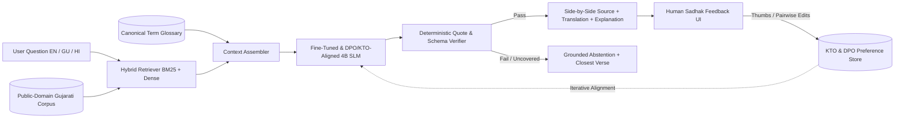

## Why KVTP Source SLM Exists

Inspired by Shrimad Rajchandra's call *Kar Vichar To Paam* (reflect deeply and attain), KVTP Source SLM addresses a recurring failure in general-purpose AI systems: conceptual distortion during spiritual translation and question answering.

Shrimad Rajchandra (1867 to 1901) composed foundational works such as *Atmasiddhi Shastra*, *Shrimad Rajchandra Vachanamrut*, *Mokshamala*, and *Apoorva Avsar* primarily in late-19th-century literary Gujarati interwoven with Sanskrit and Prakrit philosophical terms. General-purpose Large Language Models (LLMs) frequently flatten precise concepts such as *Samkit* (*Samyag Darshan*), *Bhed-gyan*, *Upayog*, *Swabhav*, *Vairagya*, and *Kashaya* into loose modern equivalents like "faith", "mindfulness", or "detachment", or blend in unrelated philosophical traditions.

KVTP Source SLM combines exact source retrieval, glossary-constrained Small Language Model (SLM) fine-tuning, and human-in-the-loop preference reinforcement learning (`KTO` and `DPO`) so seekers and study groups can ask spiritual questions in English, Hindi, or Gujarati while remaining anchored to the original text.

> [!IMPORTANT]
> Small models should never memorize sacred or canonical texts in model weights alone. Closed-book generation risks fabricating plausible quotes. Every response in KVTP Source SLM retrieves the exact source passage first and verifies character-level citation integrity in code before display.

## System Architecture



## Core Technical Stack

| Component             | Choice                                       | Engineering Rationale                                                        |
|-----------------------|----------------------------------------------|------------------------------------------------------------------------------|
| Base SLM              | `Gemma 3 4B` or `Sarvam-Translate` (4B)      | High-efficiency 256k tokenizer for Gujarati, Devanagari, and English scripts |
| Supervised Adaptation | QLoRA via `Unsloth` and Hugging Face `TRL`   | Fits within 8 to 16 GB VRAM while training terminology and citation format   |
| Human Preference RL   | `KTO` and `DPO` (`TRL`)                      | Aligns translation nuance from 150 to 300 human judgments without PPO drift  |
| Grounded Retrieval    | Hybrid search (`BM25` + multilingual dense)  | Preserves exact *Patrank* and *Gatha* lookup alongside semantic questions    |
| Output Verification   | `Outlines` / `XGrammar` + Python quote check | Enforces JSON schema and character-exact verification of Gujarati citations  |

## Milestone Summary

| Milestone   | Corpus Scope                              | Core AI Engineering Deliverable                                                       |
|-------------|-------------------------------------------|---------------------------------------------------------------------------------------|
| Milestone 1 | *Atmasiddhi Shastra* (142 *Gathas*)       | 50-term glossary, mistranslation trap benchmark, and human RL (`KTO` / `DPO`) loop    |
| Milestone 2 | *Atmasiddhi Shastra* + *Apoorva Avsar*    | QLoRA SFT + Round-2 `DPO`, grammar-constrained JSON output, and automated CI evals    |
| Milestone 3 | *Shrimad Rajchandra Vachanamrut*          | Retrieval-Augmented Fine-Tuning (`RAFT`) with distractors and verifiable quote checks |
| Milestone 4 | Full public-domain corpus                 | 4-bit quantized serving (`vLLM` / `GGUF`) and bilingual study-group web companion     |

Read the complete engineering specification, Milestone 1 human RL design, and evaluation gates in [docs/project-plan.md](./docs/project-plan.md).

## Repository Layout

```text
kvtp-source-slm/
|-- README.md
|-- LICENSE
|-- docs/
|   `-- project-plan.md
`-- data/
    `-- schemas/
        |-- glossary_entry.schema.json
        `-- preference_pair.schema.json
```

## Source Text and Copyright Policy

> [!WARNING]
> Respecting intellectual property is mandatory across every dataset split in this repository.

* Shrimad Rajchandra passed away in 1901, placing his original Gujarati, Sanskrit, and Prakrit compositions in the public domain under Indian copyright law.
* Modern English and Hindi translations, transliterations, and commentaries published by contemporary institutions or authors remain protected by copyright unless released under an explicit open license.
* Training, evaluation, and human preference datasets in this project use public-domain original verses paired with original contributor-authored translations, community-reviewed glossary definitions, and synthetic distractor examples.
